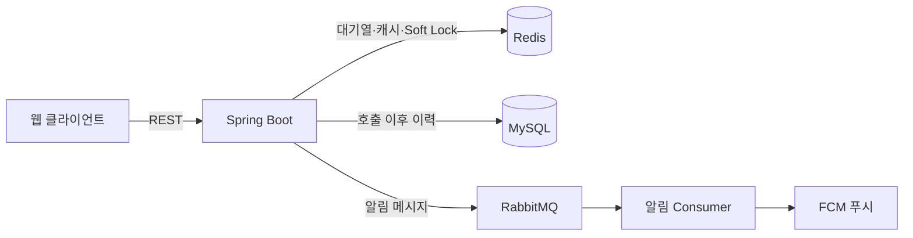

# Festin

대학 축제 부스 대기열 관리 서비스입니다. 방문객은 줄을 서는 대신 모바일로 대기를 등록해 순번을 확인하고, 호출 알림을 받으면 부스로 갑니다. 스태프는 다음 손님 호출과 입장·체험 완료를 처리합니다.

- 서비스: https://www.festin.shop
- 프론트엔드: [jiixon/festin-FE](https://github.com/jiixon/festin-FE)

## 주요 기능

| 사용자 | 기능 | API |
|---|---|---|
| 방문객 | 부스 목록·상세 조회 | `GET /api/v1/booths`, `GET /api/v1/booths/{boothId}` |
| 방문객 | 대기 등록·취소 | `POST /api/v1/waitings`, `DELETE /api/v1/waitings/{boothId}` |
| 방문객 | 순번·내 대기 목록 조회 | `GET /api/v1/waitings/booth/{boothId}`, `GET /api/v1/waitings/my` |
| 스태프 | 다음 손님 호출 | `POST /api/v1/waitings/call` |
| 스태프 | 입장·체험 완료 처리 | `POST /api/v1/booths/{boothId}/entrance/{waitingId}`, `.../complete/{waitingId}` |
| 스태프 | 부스 현황·호출 목록 조회 | `GET /api/v1/booths/{boothId}/status`, `.../called-list` |

**대기 규칙**

- 한 사용자는 최대 2개 부스에 동시에 대기할 수 있습니다. 초과하면 `409`를 반환합니다.
- 같은 부스에 다시 등록하면 기존 순번을 유지합니다. 신규 등록은 `201`, 이미 등록된 경우는 `200`입니다.
- 호출 후 5분 안에 입장하지 않으면 노쇼로 처리합니다.

전체 명세는 [`docs/api-spec`](docs/api-spec/waiting-api.md)에 있습니다.

## 아키텍처



- **대기열은 Redis에 둡니다.** 호출 전 대기는 Redis에만 있고, 호출 시점부터 MySQL에 이력을 남깁니다.
- **헥사고날 아키텍처를 따릅니다.** `booth`, `waiting`, `user`, `university`를 각각 `domain`, `application`, `adapter`로 나눴습니다. 원칙은 [`hexagonal-architecture.md`](docs/architecture/hexagonal-architecture.md)에 있습니다.

| 영역 | 기술 |
|---|---|
| 백엔드 | Java 21, Spring Boot 4.0, Spring Data JPA, Spring Security, JWT |
| 저장소·메시징 | MySQL 8.0, Redis 7.0, RabbitMQ 3, FCM |
| 테스트 | JUnit 5, Cucumber, RestAssured, Testcontainers, k6 |
| 운영 | Docker Compose, GitHub Actions, AWS EC2 (t3.micro), Prometheus, Grafana |

## 핵심 설계

### 등록은 Lua 스크립트로 원자적으로 처리합니다

"활성 부스 수 확인 → 중복 확인 → 대기열 추가"를 나눠서 실행하면, 동시 요청이 함께 검사를 통과해 2개 제한을 넘을 수 있습니다. 그래서 이 과정을 [`enqueue-atomic.lua`](src/main/resources/scripts/enqueue-atomic.lua) 하나로 묶었습니다. 등록 API는 DB에 접근하지 않습니다.

### 호출은 Soft Lock으로 Redis와 MySQL의 어긋남을 복구합니다

호출은 Redis와 MySQL을 함께 바꾸지만, 두 저장소를 하나의 트랜잭션으로 묶을 수 없습니다.

```text
1. Redis에서 대기자를 꺼냄 (원자적)
2. Soft Lock 생성 (원래 등록 시각 보존)
3. MySQL에 호출 이력 저장
4. 성공하면 Soft Lock 삭제
   실패하면 Soft Lock이 남고, 1분 주기 배치가 원래 순번으로 복구
```

`TransactionalEventListener` 방식을 직접 구현해 비교한 뒤, 복구할 때 원래 순번을 보존할 수 있는 이 방식을 골랐습니다. Outbox는 운영 복잡도에 비해 과하다고 판단해 설계 단계에서 제외했습니다.

복구 스캔은 Soft Lock 쪽이 5ms, 비교 방식이 64ms로 측정됐습니다. 다만 각각 1건과 100건을 조회한 값이라 방식 차이만 비교한 수치는 아닙니다. 측정 조건과 다른 판단 근거는 [`recovery-comparison/RESULT.md`](load-test/recovery-comparison/RESULT.md)에 있습니다. 이 비교 테스트는 현재 주석 처리되어 CI에서 실행되지 않습니다.

자세한 설계는 [`concurrency-control.md`](docs/design-decisions/concurrency-control.md)와 [`distributed-consistency.md`](docs/design-decisions/distributed-consistency.md)에 있습니다.

## 검증과 개선 사례

### 스파이크 때 응답이 19초까지 늘어난 문제

k6로 초당 500건 스파이크를 재현하니 p99가 14초까지 늘었습니다. HikariCP 대기 지표를 추적해 보니, Redis만 쓰는 등록·순번 조회 API가 불필요한 `@Transactional` 때문에 DB 커넥션을 기다리고 있었습니다.

| 스파이크 테스트 | 개선 전 | 개선 후 |
|---|---|---|
| p95 | 1,160ms | 363ms |
| p99 | 14,050ms | 558ms |
| max | 19,250ms | 1,780ms |
| 에러율 | 0% | 0% |
| 최대 VUser | 1,000 | 500 |

- **측정 조건:** 같은 스크립트로 초당 500건을 보냈습니다. 최대 VUser는 미리 정한 조건이 아니라, 목표 요청량을 맞추려고 k6가 늘린 결과입니다.
- **변경 내용:** `@Transactional` 제거와 함께 커넥션 풀을 10개에서 30개로 늘렸습니다. 제거 후 두 API는 DB 커넥션을 쓰지 않으므로 이 경로의 지연에는 풀 크기가 관여하지 않지만, 두 변경을 따로 측정하지는 않았습니다.
- **한계:** 점진 부하 테스트의 전체 p95는 86ms에서 367ms로 오히려 높아졌고 원인은 아직 분석하지 못했습니다. 위 개선은 스파이크 때의 꼬리 지연에 대한 결과입니다.

전체 기록은 [`load-test-report.md`](load-test/load-test-report.md)에 있습니다.

### 시뮬레이션으로 찾은 호출 API 장애

실사용자가 축제 기간에만 있는 서비스여서, LLM이 상황을 판단하는 가상 사용자 시뮬레이션을 만들어 GitHub Actions cron으로 반복 실행했습니다. 페르소나 기반의 대기·이탈 행동과 연타, 네트워크 재시도, 동시 등록 같은 패턴을 함께 돌립니다.

상태가 누적되자 스태프 호출 API가 첫 파동에서 100회 중 93회 `500`을 반환했습니다.

```text
1. 운영자가 시뮬레이션 사용자를 MySQL에서 직접 삭제 → Redis 대기열에 user_id만 남음
2. 호출 시 MySQL 저장에서 외래 키 위반 → 500
3. 복구 배치가 그 user_id를 원래 순번으로 되살림
4. 같은 대기자가 다시 맨 앞에 와서 반복 → 해당 부스 대기열 정지
```

- **즉시 조치:** 대기열과 `users`의 차집합을 지우는 스크립트를 넣었고, 이후 파동에서는 호출 100회 중 5xx가 0회였습니다.
- **근본 해결:** 호출 시 Soft Lock을 만들기 전에 사용자 존재를 확인해 없는 사용자는 폐기하고 다음 대기자로 넘어갑니다. 복구 배치에도 같은 판단을 넣었습니다. 재현 테스트 5종으로 검증했고, 대조군으로 실제 사용자는 여전히 원래 순번으로 복구되는지 확인합니다.
- **등록 시점 검증은 넣지 않았습니다.** 호출이 가장 많은 등록 경로에 DB 조회를 다시 넣게 되기 때문입니다.
- **함께 고친 점:** 당시 리포트의 "5xx 0건"은 5xx를 세는 지표가 없어서 나온 값이었습니다. 엔드포인트별 5xx 집계와 임계값 초과 시 워크플로 실패 처리를 추가했습니다.

이 장애의 선행 원인은 운영자의 수동 삭제이며, 실제 방문객이 영향을 받은 사고는 아닙니다. 전체 기록은 [인시던트 문서](docs/incidents/2026-06-08-callnext-fk-violation.md)와 [시뮬레이션 리포트](load-test/llm-simulation/simulation-report-phase4.md)에 있습니다.

## 실행

### 로컬 실행

Docker가 필요합니다. MySQL, Redis, RabbitMQ와 앱을 함께 띄웁니다. 로컬 프로필에서는 FCM이 꺼져 있습니다.

```bash
docker-compose -f docker-compose.local.yml up -d --build
curl http://localhost:8080/api/health
```

### 테스트

실행 중인 Docker가 필요합니다. 테스트에 쓸 컨테이너는 Testcontainers가 띄웁니다.

```bash
SPRING_TESTCONTAINERS_ENABLED=true TESTCONTAINERS_RYUK_DISABLED=true ./gradlew test
```

인수 테스트(Cucumber)와 동시성·정합성 테스트 등 43개로 구성되어 있으며, 그중 1개는 스킵됩니다.

## 배포

`main`에 머지하면 CI가 빌드와 테스트를 실행하고, CD가 Docker Hub에 이미지를 올린 뒤 EC2의 앱 컨테이너를 교체합니다. 모든 구성 요소는 EC2 한 대의 컨테이너로 운영합니다.

## 문서

| 주제 | 문서 |
|---|---|
| 요구사항 | [`docs/prd/festin-prd.md`](docs/prd/festin-prd.md) |
| 시스템 구조 | [`docs/architecture/system-architecture.md`](docs/architecture/system-architecture.md) |
| 도메인 모델 | [`docs/domain-model/domain-model.md`](docs/domain-model/domain-model.md) |
| 데이터베이스 | [`docs/database/schema.md`](docs/database/schema.md), [`docs/database/redis.md`](docs/database/redis.md) |
| 부하 테스트 | [`load-test/README.md`](load-test/README.md) |
| LLM 시뮬레이션 | [`load-test/llm-simulation/README.md`](load-test/llm-simulation/README.md) |
| 운영 런북 | [`docs/runbook-rds-to-ec2-mysql.md`](docs/runbook-rds-to-ec2-mysql.md) |
